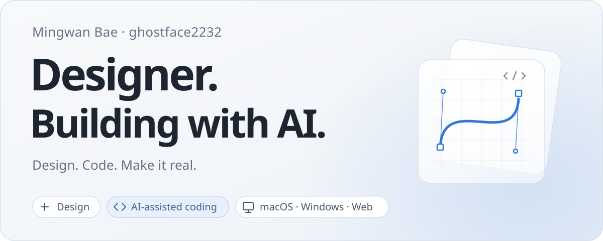

<picture>
  <source media="(max-width: 640px) and (prefers-color-scheme: dark)" srcset="https://raw.githubusercontent.com/ghostface2232/ghostface2232/2e16ae20afc9ae69435e906f502c150353790705/assets/profile-dark-mobile.svg">
  <source media="(max-width: 640px)" srcset="https://raw.githubusercontent.com/ghostface2232/ghostface2232/2e16ae20afc9ae69435e906f502c150353790705/assets/profile-light-mobile.svg">
  <source media="(prefers-color-scheme: dark)" srcset="https://raw.githubusercontent.com/ghostface2232/ghostface2232/2e16ae20afc9ae69435e906f502c150353790705/assets/profile-dark.svg">
  
</picture>

### About me
Hi, I'm Mingwan Bae, an industrial designer. I design physical objects ranging from home appliances to furniture, along with the interfaces and software I use every day. From selecting forms and materials to designing screen layouts and motion, I care deeply about crafting every detail a user sees and touches.

### Design & Development
Instead of leaving ideas as sketches or static mockups, I write code to turn them into working products. I gravitate toward clean interfaces, natural feel, and tools that stay out of the way during daily use. What I enjoy most is testing what I build firsthand, spotting subtle friction points, and smoothing them out.

### Exploring
Building on my background in physical product design, I have been collaborating with AI agents to bring functional concepts and user experiences I find intriguing to life. I love the moment an abstract idea starts moving and working on screen. By experimenting firsthand with what emerging technologies can do, I am steadily expanding the boundaries of my work.
